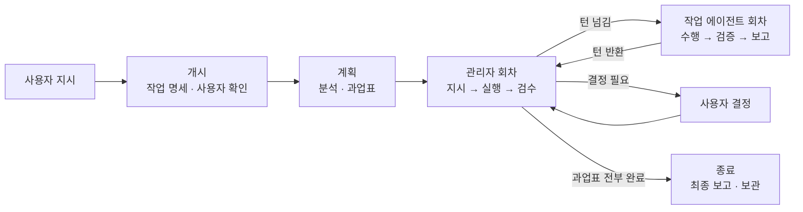

# 에이전트 팀 프로토콜

에이전트 팀은 서로 다른 제품(Claude, Codex, Antigravity 등)의 에이전트가 각자의 세션에서 팀 진행표 하나를 매개로 협업하는 팀이다. 사용자가 명시적으로 요청한 때만 구성하며 에이전트가 스스로 발동하지 않는다. 단일 세션 안에서 서브에이전트를 호출하는 방식과 Claude Code가 제공하는 같은 이름의 단일 제품 기능은 이 프로토콜의 대상이 아니다.

## Index

- [1. 환경](#1-환경)
  - [1.1 참여 에이전트](#11-참여-에이전트)
  - [1.2 실행 방식](#12-실행-방식)
  - [1.3 활용 수단](#13-활용-수단)
- [2. 역할](#2-역할)
- [3. 워크플로우](#3-워크플로우)
  - [3.1 개시](#31-개시)
  - [3.2 계획](#32-계획)
  - [3.3 실행 회차](#33-실행-회차)
  - [3.4 종료](#34-종료)
- [4. 규칙](#4-규칙)
  - [4.1 Status Board 규격](#41-status-board-규격)
  - [4.2 쓰기 권한과 턴 전환](#42-쓰기-권한과-턴-전환)
  - [4.3 지시 기준](#43-지시-기준)
  - [4.4 보고 기준](#44-보고-기준)
  - [4.5 검수 기준](#45-검수-기준)
  - [4.6 대기와 감시](#46-대기와-감시)
  - [4.7 사용자 소통 시점](#47-사용자-소통-시점)
  - [4.8 참여 지시문](#48-참여-지시문)
  - [4.9 활용 수단 규칙](#49-활용-수단-규칙)
  - [4.10 제한 사항](#410-제한-사항)
- [5. 팀 진행표 서식](#5-팀-진행표-서식)

## 1. 환경

### 1.1 참여 에이전트

참여 에이전트는 관리자와 작업 에이전트다. 작업 에이전트는 관리자 세션 밖의 별도 세션에서 구동되며 팀 진행표로 지시를 받고 보고한다. 참여 에이전트는 `<제품>-<담당>` 형식의 식별자로 부른다. 관리자의 담당은 `관리자`, 작업 에이전트의 담당은 주 과업 유형(구현, 조사, 문서, 검증)이다. 같은 담당이 둘 이상이면 번호를 붙인다. 예를 들어 `claude-관리자`, `codex-구현1`, `antigravity-검증`이다.

통신 매체는 태스크의 작업용 폴더에 두는 팀 진행표(`agent-workspace/task/<태스크명>-data/agent-team.md`) 하나다. 에이전트 간 직접 대화는 없으며 지시와 보고는 모두 팀 진행표에 기록한다.

### 1.2 실행 방식

작업 에이전트의 실행 방식은 다음과 같다. 관리자가 CLI로 작업 에이전트를 실행할 수 있으면 호출 방식을 우선한다.

| 방식 | 조건 | 동작 |
|:---|:---|:---|
| 호출 방식 | 관리자의 실행 환경에서 작업 에이전트의 CLI를 실행할 수 있음 | 관리자가 회차마다 참여 지시문을 CLI의 비대화형 실행으로 전달. 작업 에이전트는 수행과 보고를 마치고 종료 |
| 상주 방식 | 제품이 CLI를 제공하지 않거나 사용자가 설치하지 않음 | 사용자가 참여 지시문을 작업 에이전트 세션에 1회 입력. 작업 에이전트는 팀 진행표를 감시하며 상주 |

관리자는 사용자가 연 세션에서 일하므로 항상 상주 방식이다. 작업 에이전트별 실행 방식은 개시 단계에서 정하고 실행 명령과 권한 옵션은 작업 명세에 기록한다.

### 1.3 활용 수단

각 에이전트가 과업 수행에 쓸 수 있는 수단은 다음과 같다. 수단별 사용 규칙은 4.9절에 둔다.

| 수단 | 용도 | 사용 주체 |
|:---|:---|:---|
| 서브에이전트 | 자기 과업 안에서의 병렬 조사, 원문 대조, 범위가 정해진 구현 | 전원 |
| 사용자의 브라우저와 화면 제어 | 자료 조사, 로그인이 필요한 서비스 확인, UI 동작 검증 | 관리자가 지정한 에이전트 |
| 제품 고유 기능 | 각 제품이 제공하는 내부 병렬화, 클라우드 실행, 에이전트 관리 기능 | 각 에이전트 |
| 코드 저장소 | 구현 과업의 격리와 변경 추적 | 구현 작업 에이전트, 관리자 |

## 2. 역할

| 역할 | 책임 | 산출물 |
|:---|:---|:---|
| 사용자 | 목표와 팀 구성 지시, 개시 확인, 참여 지시문 전달(상주 방식), 정책 결정, 최종 결과 수신 | 지시, 결정 |
| 관리자 | 상황 분석과 판단(거시적 시야, 문제의 핵심 접근, 논리적 방향 판단), 계획과 설계, 과업 분해와 배정, 지시 작성, 결과 검수, 종합과 사용자 보고 | 작업 명세, 과업표, 회차별 지시, 검수 결과, 최종 보고 |
| 작업 에이전트 | 배정된 과업 수행(코딩, 시험, 자료 조사, 자료 분석, 문서 작성, 교차 검토), 결과와 증거 보고 | 회차별 보고, 변경 대조표, 검증 기록, 질문 |

관리자는 다음 기준으로 과업을 나눈다.

- 관리자: 분석, 설계, 검수처럼 판단이 필요한 작업을 직접 수행하고 탐색, 자료 읽기, 구현처럼 컨텍스트 윈도우를 많이 차지하는 작업은 위임
- 작업 에이전트: 다른 제품의 강점이 필요한 과업과 산출물을 만든 주체로부터 독립된 검증이 필요한 과업을 담당
- 서브에이전트: 그 밖의 위임 과업을 맡는 기본 수단. 관리자와 작업 에이전트가 각자의 과업 안에서 호출

서로 의존하지 않는 과업은 병렬로 위임한다. 모델은 AGENTS.md의 모델 선택 기준을 충족하는 범위에서 비용이 가장 낮은 것을 고른다.

## 3. 워크플로우

절차의 각 단계는 개시 S, 계획 P, 관리자 M, 작업 에이전트 W, 종료 E의 기호와 순번으로 부른다.



### 3.1 개시

요청을 받은 에이전트가 관리자를 맡는다. 사용자가 다른 관리자를 지정한 경우에는 요청을 받은 에이전트가 개시 절차만 대행한다.

- **S1** 목표를 확인하고 사용자가 참여 에이전트와 담당을 지정했으면 그 구성을 따른다. 과업이 독립적으로 나뉘지 않거나 한 제품으로 충분하면 단일 세션이나 서브에이전트 방식을 제안한다.
- **S2** 다른 제품의 에이전트마다 CLI 설치 여부와 사용 가능한 모델을 확인해 실행 방식을 정한다(1.2절). CLI가 설치되어 있지 않으면 설치 동의를 구하고 동의하지 않으면 상주 방식으로 정한다. 사용자가 참여 에이전트를 지정하지 않았으면 이 결과로 팀 구성안을 만든다.
- **S3** 다음 항목을 사용자에게 한 번에 제시하고 확인을 받는다.
  - 목표와 완료 기준
  - 팀 구성(식별자, 제품과 모델, 담당)
  - 작업 에이전트별 실행 방식(CLI 설치 동의 포함)
  - 대상 리소스와 고치지 않을 파일
- **S4** 확인을 받으면 태스크의 작업 문서가 없는 경우 먼저 만들고 5절 서식으로 팀 진행표를 생성해 Status Board를 초기화한다.
- **S5** 상주 방식의 에이전트마다 참여 지시문(4.8절)을 출력한다. 자신이 관리자가 아니면 관리자 행을 `ASSIGNED`로 두고 관리자에게도 참여 지시문을 출력한다. 이후 자기 역할의 절차로 들어간다.

### 3.2 계획

관리자가 수행한다.

- **P1** 대상 리소스와 현재 상황을 분석하고 접근 방향을 정한다.
- **P2** 작업 범위 최적화와 병렬 처리를 고려하여 과업표를 작성한다. 과업마다 ID, 내용, 담당, 의존 과업, 완료 기준, 소유 파일, 상태를 적는다. 과업 분해와 계획 수립은 다음 기준을 따른다.
  - **범위 최적화**: 목표 달성에 직결되지 않는 작업은 제외하고 회차 전환과 검수 비용이 작업량보다 커지지 않도록 완료 기준이 분명한 단위(함수 하나, 시험 파일 하나, 검토 한 건 등)로 분할
  - **의존성 분리와 병렬화**: 선행 산출물이 없어도 착수할 수 있는 과업은 의존 관계를 두지 않고 병렬 과업으로 배치
  - **소유 파일 격리**: 작업 에이전트 간 파일 수정 충돌이 일어나지 않도록 과업별 소유 파일을 배타적으로 지정
  - **관리자 위임 과업**: 관리자가 서브에이전트에게 맡기는 과업도 과업표에 포함하고 담당은 관리자로 기재

### 3.3 실행 회차

회차는 관리자가 지시를 내고 그 보고를 검수하기까지의 단위다. 지시는 과업마다 1건이며 소유 파일이 겹치지 않고 서로 의존하지 않는 과업은 한 회차에 여러 작업 에이전트에게 동시에 배정할 수 있다. 관리자는 과업표의 모든 과업이 완료될 때까지 다음을 반복한다.

- **M1** 현재 회차를 1 올리고 과업표에서 의존이 해소된 과업마다 지시(4.3절)를 자신의 작업 영역에 작성한다. 제목은 `[Round N] 지시 (과업 ID)`로 한다.
- **M2** Status Board의 담당 작업 에이전트 행을 `ASSIGNED`로, 자기 행을 `IDLE`로 바꾼다. 호출 방식이면 참여 지시문을 CLI로 실행하고 종료를 기다린다. 상주 방식이면 팀 진행표를 감시한다(4.6절).
- **M3** 자기 행이 `ASSIGNED`가 되면 `IN_PROGRESS`로 바꾸고 `REPORTED`인 작업 에이전트의 보고를 검수한다(4.5절). 합격이면 과업표의 상태를 `DONE`으로 바꾸고 불합격이면 보완 지시를 새 회차로 낸다. 검수한 작업 에이전트의 행은 `IDLE`로 되돌린다. 여러 보고가 순차적으로 도착하면 도착 순서대로 검수하고 남은 보고를 기다리는 동안 자기 행은 `IDLE`로 둔다.
- **M4** 사용자 결정이 필요하면 안건과 선택지를 작업 영역에 적고 작업 상태를 `REVIEW_REQUIRED`로 바꾼 뒤 사용자에게 묻는다. 답을 받으면 결정 사항을 기록하고 `IN_PROGRESS`로 되돌린다.

작업 에이전트는 자기 행이 `ASSIGNED`가 되면 다음을 수행한다.

- **W1** 자기 행을 `IN_PROGRESS`로 바꾸고 관리자 작업 영역에서 자기 과업의 이번 회차 지시를 읽는다. 지시에 4.3절의 항목이 빠져 있으면 착수하지 않고 질문만 담은 보고를 남긴 뒤 W4로 간다. 이때 과업 상태는 바꾸지 않는다.
- **W2** 지시를 이행하고 완료 기준에 적힌 검증을 수행한다.
- **W3** 보고(4.4절)를 자신의 작업 영역에 `[Round N] 보고 (과업 ID)` 제목으로 작성하고 과업표의 자기 과업 상태를 `REVIEW`로 바꾼다.
- **W4** 자기 행을 `REPORTED`로, 관리자 행을 `ASSIGNED`로 바꾼다. 상주 방식이면 감시로 돌아가고 호출 방식이면 종료한다.

### 3.4 종료

관리자가 수행한다.

- **E1** 과업표의 모든 과업이 `DONE`인지 확인한다.
- **E2** 최종 보고를 자신의 작업 영역에 작성한다. 목표 달성 여부, 산출물 목록, 남은 미해결 사항을 담는다.
- **E3** 작업 상태를 `COMPLETED`로 바꾼다.
- **E4** 사용자에게 결과를 보고한다.

## 4. 규칙

### 4.1 Status Board 규격

| 항목 | 값 |
|:---|:---|
| 현재 단계 | `개시` · `계획` · `실행` · `종료` |
| 현재 회차 | `Round N` (관리자가 지시를 작성할 때 1 증가) |
| 작업 상태 | `IN_PROGRESS`(진행 중) · `REVIEW_REQUIRED`(사용자 결정 대기) · `COMPLETED`(전체 완료) |
| 참여자 상태표 | 에이전트마다 한 행 기재. 상태는 `IDLE`(턴 없음) · `ASSIGNED`(지시 수신, 착수 전) · `IN_PROGRESS`(수행 중) · `REPORTED`(보고 완료, 검수 대기)이며 최종 갱신 일시를 병기 |
| 핵심 메시지 | 현재 진행 상황 1줄 요약 |

과업표의 상태는 `TODO` · `IN_PROGRESS` · `REVIEW` · `DONE` · `HOLD`로 관리한다.

### 4.2 쓰기 권한과 턴 전환

- **작업 에이전트 권한**: 팀 진행표에서 자신의 작업 영역, 과업표의 자기 과업 상태, Status Board의 자기 행과 턴을 넘길 대상 행만 수정한다. 대상 리소스는 `IN_PROGRESS` 상태일 때 지시에 명시된 소유 파일 범위 안에서만 수정한다.
- **관리자 권한**: Status Board 전체, 과업표 전체, 자신의 작업 영역을 수정한다. 여러 작업 에이전트가 함께 쓰는 공통 파일은 관리자가 소유한다.
- **갱신 순서와 충돌 방지**: 팀 진행표를 수정하기 전에 파일을 다시 읽어 최신 상태를 확인한다. 턴을 넘길 때는 작업 영역과 과업표를 먼저 저장하고 Status Board를 마지막에 갱신한다.
- **사용자 결정 반영**: 사용자 결정을 수신한 에이전트는 결정 사항을 자신의 작업 영역에 기록한다. 작업 에이전트가 수신한 경우 관리자 행을 `ASSIGNED`로 바꾸어 턴을 관리자에게 넘긴다.

### 4.3 지시 기준

지시는 다음 항목을 갖춘다. 큰 참고 자료는 파일로 두고 경로를 적는다.

| 항목 | 내용 |
|:---|:---|
| 일시 | 작성 시점 (yyyy-mm-dd hh:mm) |
| 과업 | 과업표의 ID |
| 목표 | 이번 회차에 이룰 결과 |
| 범위 | 수정할 파일, 참고할 파일, 수정하지 않을 파일 |
| 산출물 | 결과물의 형식과 위치 |
| 수단 | 사용할 도구, 출처, 활용 수단 |
| 완료 기준 | 실행할 검증(명령, 대조 방법)과 기대 결과 |
| 경계 | 이번 회차에서 다루지 않는 범위 |

### 4.4 보고 기준

보고는 회차마다 1건이며 다음 항목을 갖춘다. 큰 산출물은 파일로 저장하고 경로만 적는다.

| 항목 | 내용 |
|:---|:---|
| 일시 | 작성 시점 (yyyy-mm-dd hh:mm) |
| 결과 | 수행 결과 요약 |
| 변경 대조표 | 대상 리소스를 수정한 경우 위치, 변경 전, 변경 후, 사유 열로 구성된 표. 변경 전은 실제 파일의 기존 문장을 원문 그대로 기재 |
| 검증 기록 | 실행한 명령과 결과 원문, 완료 기준과의 대조 결과 |
| 결정 | 수행 중 스스로 내린 판단과 근거 |
| 질문 | 관리자나 사용자의 판단이 필요한 사항 |
| 미해결 | 완료하지 못한 사항과 사유 |

### 4.5 검수 기준

관리자는 보고만으로 판정하지 않고 다음을 직접 확인한다.

- 변경 대조표와 대상 리소스의 실제 내용 대조
- 완료 기준에 명시된 검증 절차 재실행
- 범위 밖 변경 유무 점검 (발견 시 원상 복구 지시)
- 보고가 참조한 파일과 경로의 실재 여부 확인 (존재하지 않는 참조가 있으면 미완료 판정)

### 4.6 대기와 감시

상주 방식의 에이전트는 자기 턴이 아닐 때 Status Board의 자기 행을 감시한다.

- **감시 수단**: 실행 환경이 제공하는 백그라운드 파일 감시나 주기적 타이머 활용
- **제한 시간**: 감시 도구 만료 시 즉시 재설정
- **자기 행 변경**: Status Board 재확인 후 해당 역할의 수행 절차로 진입
- **팀 종료**: 작업 상태가 `COMPLETED`로 전환되면 감시 종료
- **출력 제한**: 작업 에이전트는 감시 상태에서 사용자에게 상태 메시지를 출력하지 않음

### 4.7 사용자 소통 시점

에이전트가 사용자에게 메시지를 내는 시점은 다음으로 한정한다.

| 시점 | 주체 | 내용 |
|:---|:---|:---|
| 개시 확인 | 개시 에이전트 | 목표와 완료 기준, 팀 구성과 담당, 실행 방식, 대상 리소스의 확인 요청 |
| 참여 지시문 | 개시 에이전트 | 상주 방식 에이전트별 지시문 1회 출력 |
| 진행 중 | 관리자 | 진행 보고 |
| 결정 필요 | 관리자 | 안건과 선택지 제시 |
| 최종 완료 | 관리자 | 결과 보고 |
| 감시 종료 | 작업 에이전트 | 감시 종료 1줄 안내 |

진행 보고는 다음 기준을 따른다.

- **보고 시점**: 과업 상태나 회차 변경 시점, 과업 규모에 비해 특정 상태가 오래 지속되는 시점
- **첫 줄**: 「전체 N개 과업 중 M개 완료, Round K」
- **과업 현황**: 과업표의 ID, 과업, 담당, 상태를 표로 표시
  - **진행 중인 과업**: 하는 일 한 줄 병기
- **정체 보고**: 경과 시간과 확인한 원인 병기

### 4.8 참여 지시문

참여 지시문은 참여 에이전트가 프로토콜과 팀 진행표를 찾아 자기 역할을 시작하게 하는 문구다. 호출 방식에서는 관리자가 회차마다 CLI 명령의 입력으로 전달하고 상주 방식에서는 개시 때 출력한 문구를 사용자가 해당 세션에 1회 입력한다.

```text
`agent-workspace/task/<태스크명>-data/agent-team.md`에 에이전트 팀 작업이 등록되었습니다.
당신은 [에이전트 식별자]([역할])입니다. 에이전트 팀 프로토콜(`agent-workspace/protocols/agent-team.md`)을 읽고 팀 진행표의 작업 명세와 Status Board를 확인한 뒤 [Round N] 지시를 수행해 주세요.
```

상주 방식에서는 마지막 문장을 「배정된 역할의 수행 절차를 시작해 주세요」로 바꾼다.

### 4.9 활용 수단 규칙

- **서브에이전트**: 호출한 에이전트가 결과를 책임진다. 팀 진행표에는 개별 호출 내역이 아닌 종합한 결과만 기록한다.
- **사용자의 브라우저와 화면 제어**: 동시에 한 에이전트만 사용한다. 조회와 열람은 지시 범위 안에서 수행하되, 제출·결제·전송·삭제·설정 변경과 같은 상태 변경 행위는 사용자 결정을 거친 뒤 수행한다. 자격 증명은 입력하지 않는다.
- **제품 고유 기능**: 자기 과업 범위 안에서 재량으로 쓴다. 팀의 상태와 공식 기록은 팀 진행표에만 둔다.
- **코드 저장소**: 작업 에이전트마다 소유 파일을 분리한다. 병렬 회차의 구현 과업은 워크트리나 브랜치로 격리한다.

### 4.10 제한 사항

- 개시 확인을 받기 전에는 대상 리소스를 수정하지 않는다.
- 관리자는 작업 에이전트에게 배정한 과업을 직접 수행하지 않고 검수 없이 완료로 처리하지 않는다.
- 작업 에이전트는 작업 범위를 임의로 확장하거나 계획을 변경하지 않으며 과업 완료를 스스로 판정하지 않는다. 지시가 불명확한 경우 추론으로 진행하지 않고 질문한다.
- 어느 에이전트도 다른 에이전트의 작업 영역을 수정하지 않는다. 직전 기록이 비어 있거나 불명확하면 대필하거나 완료 처리하지 않고 질문을 남긴다.
- 세션 간 상태 중계나 턴 도래 알림을 사용자에게 요청하지 않는다.

## 5. 팀 진행표 서식

아래 서식을 복사하여 `agent-workspace/task/<태스크명>-data/agent-team.md` 파일을 생성한다.

```markdown
# [태스크명] 에이전트 팀 진행표

## 1. 작업 명세

### 1.1 목표
(작업 목표)

### 1.2 완료 기준
- (전체 과업의 완료를 판정하는 기준)

### 1.3 주요 지침
- (지킬 원칙, 참고할 지침)

### 1.4 대상 리소스
- 대상 파일:
- 참고 문서:
- 고치지 않을 파일:

### 1.5 참여 에이전트
| 식별자 | 제품과 모델 | 역할 | 실행 방식 | 실행 명령 |
| :--- | :--- | :--- | :--- | :--- |
| claude-관리자 | Claude Code (opus) | 관리자 | 해당 없음 | 해당 없음 |
| codex-구현1 | Codex CLI (gpt) | 작업 에이전트 | 호출 방식 | `codex exec ...` |
| antigravity-검증 | Antigravity (gemini) | 작업 에이전트 | 상주 방식 | 해당 없음 |

---

## 2. Status Board

| 항목 | 값 |
| :--- | :--- |
| **현재 단계** | 계획 |
| **현재 회차** | Round 0 |
| **작업 상태** | `IN_PROGRESS` |
| **핵심 메시지** | (현재 진행 상황 1줄 요약) |

| 에이전트 | 상태 | 최종 갱신 |
| :--- | :--- | :--- |
| claude-관리자 | `IN_PROGRESS` | yyyy-mm-dd hh:mm |
| codex-구현1 | `IDLE` | yyyy-mm-dd hh:mm |
| antigravity-검증 | `IDLE` | yyyy-mm-dd hh:mm |

---

## 3. 과업표

| ID | 과업 | 담당 | 의존 | 완료 기준 | 소유 파일 | 상태 |
| :--- | :--- | :--- | :--- | :--- | :--- | :--- |
| T1 | | codex-구현1 | 없음 | | | `TODO` |
| T2 | | antigravity-검증 | T1 | | | `TODO` |

---

## 4. claude-관리자 작업 영역

### [Round 1] 지시 (T1)

- **일시**: yyyy-mm-dd hh:mm
- **과업**: T1
- **목표**:
- **범위**:
- **산출물**:
- **수단**:
- **완료 기준**:
- **경계**:

### [Round 1] 검수 (T1)

- **일시**: yyyy-mm-dd hh:mm
- **판정**: 합격 / 불합격 / 사용자 결정 필요
- **확인 내용**:

---

## 5. codex-구현1 작업 영역

### [Round 1] 보고 (T1)

- **일시**: yyyy-mm-dd hh:mm
- **결과**:
- **변경 대조표**:
  | 위치 | 변경 전 | 변경 후 | 사유 |
  | :--- | :--- | :--- | :--- |
  | | | | |
- **검증 기록**:
- **결정**:
- **질문**:
- **미해결**:

---

## 6. antigravity-검증 작업 영역

(같은 서식. 참여 에이전트마다 작업 영역을 하나씩 둔다)
```
