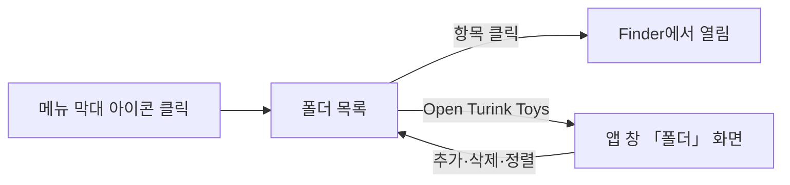

# 자주 쓰는 폴더 바로가기 제안

목업: https://claude.ai/artifact/NJNUst9KLgMXNKKa8tBzNC

## 1. 문제와 목표

자주 사용하는 폴더는 대략 10~20개이며 사람에 따라 더 많을 수 있고 바탕화면과 OneDrive, 외장 디스크 등에 흩어져 있다. Finder 사이드바와 Dock 스택이 유사한 기능을 제공하지만 Finder 창이나 Dock을 거쳐야 하며, 에이전트나 터미널에서는 동일한 목록을 사용할 수 없다. 목표는 다음과 같다.

- 어떤 앱을 사용하든 두 번의 클릭으로 폴더 열기
- 긴 경로를 확인하지 않고도 대상 폴더 식별
- 별도 설명 없이 직관적인 추가·삭제·순서 변경 수행
- 사람과 에이전트의 동일 목록 사용

## 2. 핵심 결정

| 결정 | 내용 | 이유 |
|:---|:---|:---|
| 메뉴 막대를 진입점으로 설정 | 메뉴 막대 아이콘을 누르면 폴더 목록이 바로 표시되고 항목을 선택하면 Finder에서 열린다 | 앱 창을 열고 화면을 선택하는 단계가 없으며 메뉴 막대는 어떤 앱에서든 접근할 수 있다 |
| 평면 목록 | 트리나 하위 메뉴 없이 한 줄에 폴더 하나씩 표시 | 10~20개 항목은 한눈에 파악할 수 있으며, 흩어진 위치를 트리 구조로 묶으면 오히려 찾기 어렵다 |
| 이름 중심 표시 | 폴더 이름을 강조하고 위치는 보조 정보로 표시 | 경로는 길이가 일정하지 않고 사용자가 대부분 확인하지 않는다 |
| 앱 창에서 편집 | 추가·삭제·순서 변경·이름 변경은 「폴더」 화면에서 수행한다 | 메뉴 막대 메뉴는 폴더를 여는 항목만 두어 짧고 훑어보기 쉽게 유지한다 |
| 코어 명령으로 제공 | `folders.*` 작업으로 목록을 조회하고 수정한다 | 터미널과 에이전트가 동일한 목록을 공유한다 |

## 3. 사용 흐름

폴더를 추가하는 방법은 다음과 같다. 어떤 방법으로 추가하더라도 동일한 목록에 반영된다.

| 방법 | 동작 | 용도 |
|:---|:---|:---|
| 메뉴 막대 아이콘에 드래그 | Finder에서 폴더를 끌어 메뉴 막대 아이콘에 놓기 | 창을 열지 않고 바로 추가하는 가장 빠른 방법 |
| Finder 빠른 동작 | 폴더를 오른쪽 클릭한 뒤 「Add to Turink Toys」 선택 | 기존에 설치된 빠른 동작과 동일한 방식 |
| 앱 창 | 「폴더」 화면 목록에 끌어 놓거나 「추가」 단추로 선택 | 여러 항목을 한 번에 정리할 때 |
| 터미널·에이전트 | `turink-toys folders.add <경로>` | 자동화 |

## 4. 항목 표시 규칙

| 요소 | 규칙 | 예 |
|:---|:---|:---|
| 이름 | 기본값은 폴더 이름이며, 사용자가 직접 변경할 수 있다 | `turink-toys` |
| 위치 | 경로 시작 부분을 위치 이름으로 대체하고 중간 경로는 축약하여 표시한다 | `바탕화면 › project › … › labs` |
| 위치 출처 | 홈, 바탕화면, 문서, 다운로드, iCloud, OneDrive, 외장 디스크를 구분하는 작은 표시를 덧붙인다 | OneDrive 항목에 구름 표시 |
| 같은 이름 | 이름이 중복되는 항목에만 괄호로 구분 정보를 추가한다 | `docs (OneDrive)`, `docs (바탕화면)` |
| 연결되지 않은 폴더 | 외장 디스크가 분리되었거나 동기화되지 않은 폴더는 흐리게 비활성화하여 선택할 수 없도록 하되, 목록에서 삭제하지는 않는다 | 흐린 글씨와 「연결되지 않음」 |

메뉴 막대 메뉴에는 이름만 표시하며, 마우스를 올리면 전체 경로가 도움말로 나타난다. macOS 14.4 이후 버전에서는 이름 아래에 위치를 작은 글씨로 함께 표시한다.

## 5. 「폴더」 화면

앱 창에 「폴더」 화면을 추가한다. 목록의 각 줄은 다음과 같이 구성된다.

- 왼쪽: 드래그하여 순서를 변경하는 끌기 손잡이
- 가운데: 폴더 이름과 위치(두 번 클릭하여 이름 변경 가능)
- 오른쪽: 마우스를 올렸을 때 나타나는 「Finder에서 열기」·「경로 복사」·「제거」 동작

목록 항목을 한 번 클릭하면 Finder에서 열린다. 목록 상단에는 「추가」 단추와 폴더를 끌어다 놓을 수 있다는 안내를 표시한다. 등록된 항목이 없을 때는 목록에 끌어 놓기, 메뉴 막대 아이콘에 끌어 놓기, 「추가」 단추로 추가하는 세 가지 방법을 안내한다.

## 6. 코어 명령

| 명령 | 역할 |
|:---|:---|
| `folders.list` | 목록과 각 항목의 연결 상태 보고 |
| `folders.add` | 경로를 목록 끝에 추가(이름 지정 가능) |
| `folders.remove` | 항목 제거 |
| `folders.open` | 항목을 Finder에서 열기 |
| `folders.reorder` | 순서 변경 |

목록은 기존 설정 저장소에 보관한다. 경로는 문자열로 저장하며 폴더 위치가 이동되면 연결되지 않은 항목으로 표시한다.

## 7. 범위

| 단계 | 내용 |
|:---|:---|
| 1차 | 메뉴 막대 목록, 「폴더」 화면(추가·삭제·정렬·이름 변경), 메뉴 막대 아이콘 드래그 추가, 코어 명령 |
| 2차 | Finder 빠른 동작 「Add to Turink Toys」, 전역 단축키로 메뉴 열기, 이름 있는 구분선으로 가벼운 묶기 |
| 검토 중 | ⌥ 키를 누른 상태로 선택 시 터미널에서 열기 |

## 8. 결정 필요 사항

- 메뉴 막대 메뉴 내 폴더 목록 위치(「Open Turink Toys」 상단 또는 하단): 가장 자주 사용하는 항목이 아이콘과 가까운 상단 배치 제안
- 화면 명칭(「폴더」 또는 「즐겨찾기」): 사이드바의 다른 항목과 동일한 명사형인 「폴더」 제안

## 참고

- Apple Human Interface Guidelines, The menu bar: https://developer.apple.com/design/human-interface-guidelines/the-menu-bar
- 유사 앱: Folder Peek, XMenu, OpenFolder, My Favorites (메뉴 막대에서 폴더 목록을 여는 방식을 공통으로 적용)
