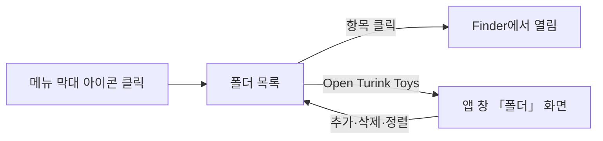

# 자주 쓰는 폴더 바로가기 제안

목업: https://claude.ai/artifact/NJNUst9KLgMXNKKa8tBzNC

## 1. 문제와 목표

자주 여는 폴더는 10~20개이고 바탕화면, OneDrive, 외장 디스크 등에 흩어져 있다. Finder 사이드바와 Dock 스택이 같은 일을 하지만 Finder 창이나 Dock을 거쳐야 하고 에이전트나 터미널에서는 같은 목록을 쓸 수 없다. 목표는 다음과 같다.

- 어떤 앱을 쓰고 있든 두 번의 클릭으로 폴더를 연다
- 긴 경로를 읽지 않고도 어느 폴더인지 알아본다
- 추가, 삭제, 순서 변경이 설명 없이 된다
- 사람과 에이전트가 같은 목록을 쓴다

## 2. 핵심 결정

| 결정 | 내용 | 이유 |
|:---|:---|:---|
| 진입점은 메뉴 막대 | 메뉴 막대 아이콘을 누르면 폴더 목록이 바로 나온다. 항목을 누르면 Finder에서 열린다 | 앱 창을 열고 화면을 고르는 단계가 없다. 메뉴 막대는 어떤 앱에서든 보인다 |
| 평면 목록 | 트리나 하위 메뉴 없이 한 줄에 폴더 하나 | 10~20개는 한눈에 들어오고 흩어진 위치를 트리로 묶으면 오히려 찾기 어렵다 |
| 이름 중심 표시 | 폴더 이름을 크게, 위치는 보조 정보로 | 경로는 길이가 제각각이고 대부분 읽지 않는다 |
| 편집은 앱 창에서 | 추가, 삭제, 순서 변경, 이름 바꾸기는 「폴더」 화면에서 한다 | 메뉴 막대 메뉴는 여는 용도로만 두어 빠르게 유지한다 |
| 코어 명령으로 제공 | `folders.*` 작업으로 목록을 읽고 고친다 | 터미널과 에이전트가 같은 목록을 쓴다 |

## 3. 사용 흐름

폴더를 추가하는 방법은 다음과 같다. 어느 방법으로 추가하든 같은 목록에 들어간다.

| 방법 | 동작 | 용도 |
|:---|:---|:---|
| 메뉴 막대 아이콘에 드래그 | Finder에서 폴더를 끌어 메뉴 막대 아이콘에 놓는다 | 가장 빠른 방법. 창을 열지 않는다 |
| Finder 빠른 동작 | 폴더를 오른쪽 클릭하고 「Add to Turink Toys」를 고른다 | 이미 설치되는 빠른 동작과 같은 방식 |
| 앱 창 | 「폴더」 화면의 목록에 끌어 놓거나 「추가」 단추로 고른다 | 여러 개를 한 번에 정리할 때 |
| 터미널·에이전트 | `turink-toys folders.add <경로>` | 자동화 |

## 4. 항목 표시 규칙

| 요소 | 규칙 | 예 |
|:---|:---|:---|
| 이름 | 기본값은 폴더 이름. 사용자가 바꿀 수 있다 | `turink-toys` |
| 위치 | 경로의 앞부분을 위치 이름으로 바꾸고 가운데를 줄인다 | `바탕화면 › project › … › labs` |
| 위치 출처 | 홈, 바탕화면, 문서, 다운로드, iCloud, OneDrive, 외장 디스크를 구분하는 작은 표시 | OneDrive 항목에 구름 표시 |
| 같은 이름 | 이름이 겹치는 항목에만 괄호로 구분 정보를 붙인다 | `docs (OneDrive)`, `docs (바탕화면)` |
| 연결되지 않은 폴더 | 외장 디스크를 뺐거나 동기화되지 않은 폴더는 흐리게 표시하고 누를 수 없다. 목록에서 지우지는 않는다 | 흐린 글씨와 「연결되지 않음」 |

메뉴 막대 메뉴에서는 이름만 보이고 전체 경로는 마우스를 올리면 도움말로 보인다. macOS 14.4 이후에서는 이름 아래에 위치를 작은 글씨로 함께 보인다.

## 5. 「폴더」 화면

앱 창에 「폴더」 화면을 추가한다. 목록의 한 줄은 다음으로 이루어진다.

- 왼쪽: 끌기 손잡이. 끌어서 순서를 바꾼다
- 가운데: 폴더 이름과 위치. 이름을 두 번 누르면 바꿀 수 있다
- 오른쪽: 마우스를 올리면 「Finder에서 열기」, 「경로 복사」, 「제거」가 나타난다

줄을 한 번 누르면 Finder에서 열린다. 목록 위에는 「추가」 단추와 폴더를 끌어 놓을 수 있다는 안내가 있다. 항목이 없을 때는 추가하는 세 가지 방법을 안내한다.

## 6. 코어 명령

| 명령 | 역할 |
|:---|:---|
| `folders.list` | 목록과 각 항목의 연결 상태를 보고 |
| `folders.add` | 경로를 목록 끝에 추가. 이름을 함께 지정할 수 있다 |
| `folders.remove` | 항목 제거 |
| `folders.open` | 항목을 Finder에서 열기 |
| `folders.reorder` | 순서 변경 |

목록은 기존 설정 저장소에 둔다. 경로는 문자열로 저장하며 폴더가 옮겨지면 연결되지 않은 항목으로 표시한다.

## 7. 범위

| 단계 | 내용 |
|:---|:---|
| 1차 | 메뉴 막대 목록, 「폴더」 화면(추가·삭제·정렬·이름 바꾸기), 메뉴 막대 아이콘 드래그 추가, 코어 명령 |
| 2차 | Finder 빠른 동작 「Add to Turink Toys」, 전역 단축키로 메뉴 열기, 이름 있는 구분선으로 가벼운 묶기 |
| 검토 중 | ⌥ 키를 누른 채 선택하면 터미널에서 열기 |

## 8. 결정이 필요한 사항

- 메뉴 막대 메뉴에서 폴더 목록을 「Open Turink Toys」 위에 둘지 아래에 둘지. 제안은 위(가장 자주 쓰는 항목이 아이콘과 가깝다)
- 화면 이름을 「폴더」로 할지 「즐겨찾기」로 할지. 제안은 「폴더」(사이드바의 다른 항목과 같은 명사형)

## 참고

- Apple Human Interface Guidelines, The menu bar: https://developer.apple.com/design/human-interface-guidelines/the-menu-bar
- 유사 앱: Folder Peek, XMenu, OpenFolder, My Favorites (메뉴 막대에서 폴더 목록을 여는 방식이 공통)
