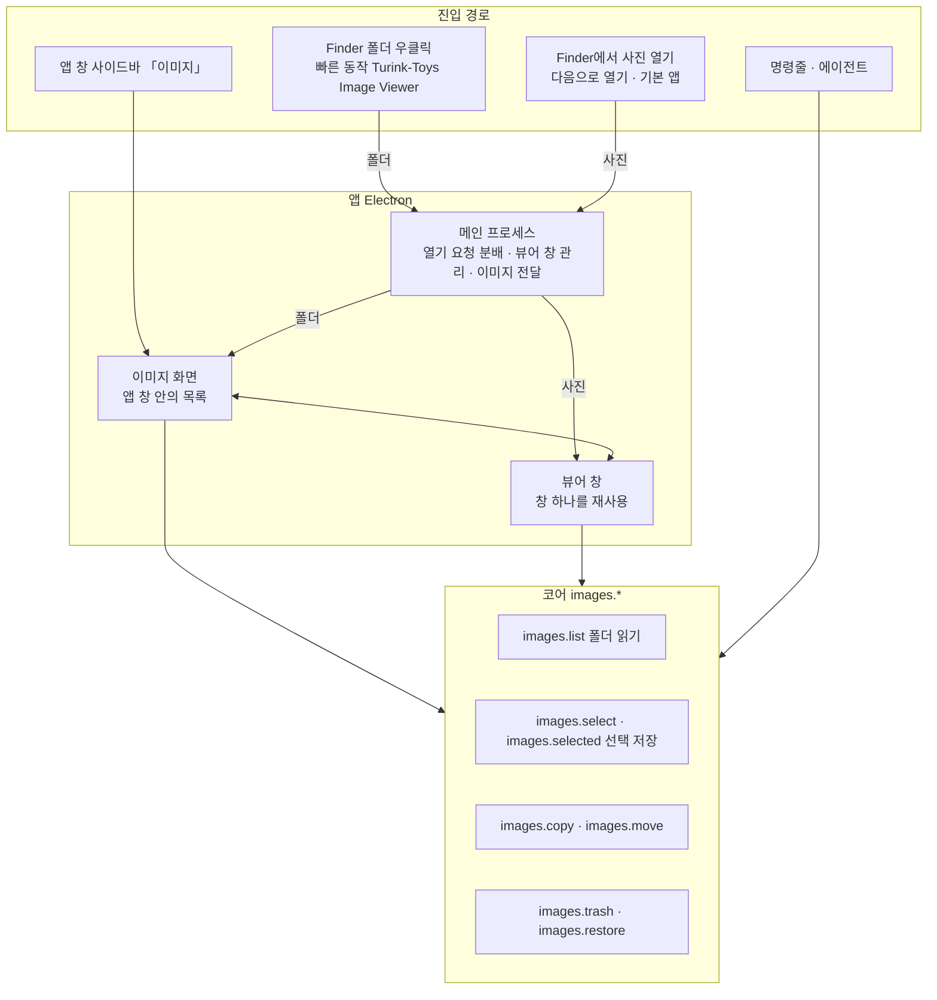

# 이미지 뷰어 설계

작성일: 2026-11-03

연관 문서: [UX 결과와 결정](ux-report.md) · [세부 설계](design-detail.md) · [시안](mockup/index.html)

## 1. 전체 구조

Turink Toys의 원칙대로, 파일을 읽고 바꾸는 일은 모두 코어 태스크(`images.*`)가 맡는다. 앱 창, 뷰어 창, Finder 빠른 동작, 명령줄, 에이전트는 같은 태스크를 부른다. 앱에만 있는 것은 사진을 화면에 그리는 일(썸네일, 확대, 넘기기)뿐이다.

## 2. 코어 태스크

| 태스크 | 하는 일 | 위험도 | 되돌리기 |
|:---|:---|:---|:---|
| `images.list` | 폴더의 하위 폴더와 사진 목록. Finder와 같은 이름순 | 읽기 | 해당 없음 |
| `images.selected` | 선택한 사진 목록. 지워졌거나 다른 곳에서 옮겨진 파일은 따로 알려 줌 | 읽기 | 해당 없음 |
| `images.select` | 사진 선택·해제, 전체 해제 | 설정 변경 | 다시 선택 |
| `images.copy` | 사진을 폴더로 복사. 같은 이름이 있으면 번호를 붙임 | 생성 | 복사본 삭제(되돌리기 없음) |
| `images.move` | 사진을 폴더로 옮김. 선택 목록의 경로도 따라 바꿈 | 변경 | 원래 폴더로 다시 옮김 |
| `images.trash` | 사진을 휴지통으로 | 삭제(확인 필요) | `images.restore` |
| `images.restore` | 휴지통으로 보낸 사진을 원래 자리로 | 생성 | 해당 없음 |

- 선택 목록은 코어 설정 파일에 저장한다. 그래서 앱을 닫아도 남고, 에이전트에게 「선택한 사진을 정리해 줘」라고 맡길 수도 있다.
- `images.trash` 는 다른 삭제 태스크처럼 계획을 확인해야 실행된다. 뷰어에서 ⌘⌫를 누르는 것을 그 확인으로 보고 바로 실행한다(Finder의 ⌘⌫와 같음). 실행 뒤에는 되돌리기 알림을 띄운다.
- 목록은 사진의 가로세로 크기를 읽지 않는다. 폴더에 사진이 많아도 바로 열리도록 하기 위해서이며, 크기는 사진을 화면에 띄울 때 알게 된다.

## 3. 앱

### 화면과 창

| 구성 | 내용 |
|:---|:---|
| 이미지 화면(앱 창) | 사이드바에 「이미지」 추가. 위치 메뉴와 경로, 하위 폴더와 썸네일, 큰 미리보기, 선택한 사진 모아보기, 복사·이동 |
| 뷰어 창 | 별도 창 하나를 재사용한다. Finder에서 다른 사진을 열어도 새 창을 만들지 않는다 |
| 창 버튼(닫기·최소화·확대) | 평소에는 숨기고, 위쪽 가장자리에 마우스를 댈 때 정보 막대와 함께 보인다 |
| 전체화면 | 별도 데스크톱으로 넘어가지 않는 방식(지금 화면을 그대로 덮음) |
| 보기 설정 | 이미지 화면의 「보기 설정」 메뉴에 마우스 휠, 뷰어 창 크기 방식. 기본값은 확정안 |

### 사진을 화면에 띄우는 방법

| 형식 | 방법 |
|:---|:---|
| JPEG, PNG, GIF(움직임 포함), WebP, AVIF, BMP | 앱이 직접 그림 |
| HEIC·HEIF(아이폰 사진), TIFF, RAW(카메라 원본) | 화면 크기 사진은 macOS 썸네일 기능으로 바로 보여 주고, 확대해서 원본 크기가 필요하면 macOS 기본 변환 도구로 만들어 캐시에 둠. 보정·현상은 하지 않음 |
| 썸네일 | Finder와 같은 macOS 썸네일 기능으로 만들고 메모리에 캐시 |

- 앞뒤 사진 두 장씩을 미리 읽어 두어 넘길 때 기다리지 않게 한다.
- 사진 파일만 앱으로 전달한다. 다른 종류의 파일은 화면에 넘기지 않는다.

### 조작

시안과 [UX 결과](ux-report.md) 2절의 조작표, 「맥북 트랙패드」 규칙을 그대로 따른다. 확대·이동 계산과 트랙패드·마우스 구분은 시험할 수 있도록 별도 모듈로 분리한다.

## 4. 진입 경로

| 경로 | 동작 |
|:---|:---|
| Finder 폴더 우클릭 > 빠른 동작 > Turink-Toys Image Viewer | 앱 창이 이미지 화면으로 열리고 그 폴더를 보여 줌 |
| 같은 메뉴를 사진 파일에서 | 뷰어 창으로 그 사진을 열고 같은 폴더를 넘길 수 있게 함 |
| Finder 「다음으로 열기」, 기본 앱 지정 | 앱 정보에 이미지 형식을 등록함. 기본 앱으로 지정하면 더블클릭으로 뷰어 창이 열림 |
| 앱 창 사이드바 「이미지」 | 마지막으로 본 폴더, 처음이면 사진 폴더 |
| 메뉴 막대(상단 시스템 메뉴)의 Turink Toys 메뉴 | 이미지 뷰어 항목을 넣지 않는다(사용자, 11-03) |

빠른 동작 이름 정리: 기존 항목을 포함해 모두 `Turink-Toys` 접두어를 붙인다(Turink-Toys Safe compress, Turink-Toys Safe extract, Turink-Toys Verify Windows compatibility, Turink-Toys Image Viewer). 설치할 때 접두어 없는 예전 이름은 지운다.

## 5. 구현 단계

| 단계 | 내용 | 확인 방법 |
|:---|:---|:---|
| 1 | 코어 `images.*` 7개와 한국어 문구 | 단위 테스트, 명령줄 실행 |
| 2 | 메인 프로세스: 이미지·썸네일 전달, 뷰어 창 관리, 열기 요청 분배, 보기 설정 저장 | 개발용 앱 실행 |
| 3 | 이미지 화면(앱 창) | 시안과 대조 |
| 4 | 뷰어 창과 확대·넘기기·트랙패드 | 확대 계산과 입력 구분 단위 테스트, 맥북 트랙패드로 직접 확인 |
| 5 | 앱 정보 등록(다음으로 열기·기본 앱), 빠른 동작 추가와 이름 정리, README | 개발용 앱 재설치 후 Finder에서 확인 |

## 6. 검수에서 확인한 위험

| 위험 | 대응 |
|:---|:---|
| Electron이 HEIC·TIFF·RAW를 직접 그리지 못함 | macOS 썸네일 기능과 기본 변환 도구(sips)를 씀. 구현 2단계 첫 작업으로 실제 파일로 확인 |
| 트랙패드와 마우스 휠 구분이 움직임 모양에 기대는 추정 | 시안에서 맥북으로 확인함. 앱에서 한 번 더 확인하고, 틀리는 경우가 있으면 보기 설정에서 휠 동작을 바꿀 수 있게 둠 |
| 선택(P)을 빠르게 누르는 동안 이동·복사가 돌면 코어의 작업 잠금에 걸릴 수 있음 | 선택은 잠금 충돌 시 짧게 다시 시도하고, 그래도 실패하면 알림 |
| 사진이 수천 장인 폴더 | 목록은 크기 정보 없이 읽고, 썸네일은 화면에 보이는 것만 만듦 |
| 기본 앱 등록이 다른 뷰어를 밀어냄 | 「대체 앱」 등급으로 등록해 사용자가 직접 지정할 때만 기본 앱이 됨 |

## 7. 이번 범위에서 뺀 것

- 편집(회전 저장, 자르기, 보정), 별점·색 라벨, 두 장 비교 보기
- 날짜순 정렬(첫 버전은 이름순만), 슬라이드쇼, 압축 파일 안 사진 보기
- 뷰어를 여는 명령줄 태스크(에이전트가 사진을 띄워 보여 주는 기능)는 필요해지면 추가
