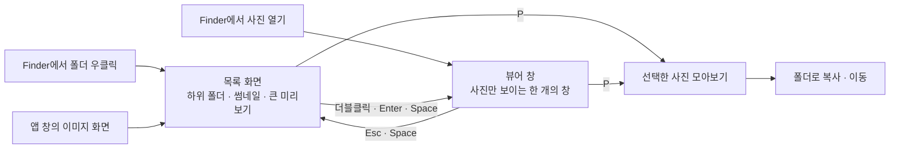

# 이미지 뷰어 UX 리서치 결과와 방향

작성일: 2026-11-03

연관 문서: [macOS 뷰어 조사](research-macos.md) · [다른 플랫폼 뷰어 조사](research-cross-platform.md) · [셀렉 도구 조사](research-culling.md) · [시안](mockup/index.html)

## 1. 리서치에서 확인한 것

### 사람들이 불편해하는 지점

| 불편 | 어디서 나오나 | 근거 |
|:---|:---|:---|
| 사진 하나를 열면 같은 폴더의 다음 사진으로 넘어가지 못함 | 미리보기, 훑어보기 | 2008년부터 반복된 1순위 불만. 2026년 신작 Vista의 제작 동기도 같음 |
| 컨트롤과 창 버튼이 사진을 가림 | Pixea | 앱스토어 리뷰에서 가장 많은 불만(마우스만 움직여도 툴바가 뜸) |
| 사진을 넘길 때마다 창 크기와 위치가 바뀜 | Pixea, Windows 사진 앱 | "다음 사진에서 창이 화면 가운데로 튄다" |
| 폴더마다 접근 허가를 요구해서 넘김이 끊김 | Pixea, PicView(샌드박스 앱) | 리뷰 다수. Turink Toys는 샌드박스 앱이 아니라 해당 없음 |
| 전체화면이 별도 데스크톱(Space)으로 넘어감 | Pixea, Phiewer | "다른 화면으로 가 버려 방해된다" |
| 휠이 기대와 다른 일을 함 | 여러 앱 | 휠이 넘기기인지 확대인지 앱마다 다르고 논쟁도 반복됨 |
| 실행·다음 사진이 느림 | Windows 사진 앱, 알씨 | 느린 실행이 이탈의 가장 큰 이유 |

### 좋은 평가를 받는 공통점

| 패턴 | 대표 앱 |
|:---|:---|
| 하나를 열면 그 폴더 전체가 넘김 대상이 됨 | 꿀뷰, qView, Xee³, Vista |
| 화면 대부분이 사진이고, 컨트롤은 가장자리에 마우스를 댈 때만 나옴 | JPEGView, FastStone, qimgv |
| 다음 사진이 바로 뜸(앞뒤 사진 미리 읽기) | ImageGlass, qView, Vista |
| 창은 처음 열 때만 사진에 맞추고 넘기는 동안은 고정 | qView(기본값, 화면의 20~70% 범위) |
| 맞춤·너비·100%를 키 하나로 오감, 확대 비율 유지 여부를 토글로 고름 | 꿀뷰(9·8·0, Ctrl+K), qimgv(1·2·3) |
| 클릭 한 번으로 맞춤과 100%를 오감 | FastStone |
| 휠 하나에는 한 가지 일만 맡기고, 반대 동작은 수정 키 조합에 둠 | 꿀뷰(휠 넘기기, Ctrl+휠 확대) |
| 고르기는 키 하나로 표시하고, 고른 것만 모아 보고, 폴더로 복사 | Photo Mechanic, FastRawViewer, qimgv |

셀렉 도구 조사의 결론: 별점·색 라벨·비교 보기는 전문가용이다. 가볍게 고르려면 **키 하나로 선택, 선택한 것만 모아 보기, 폴더로 복사·이동, 앱을 닫아도 선택 유지**만 있으면 대부분 충분하다.

## 2. 방향

### 원칙

1. 사진을 열면 그 폴더 전체를 바로 넘길 수 있다. 정렬은 Finder와 같은 이름순이다.
2. 뷰어 창에는 사진만 보인다. 파일 이름, 위치, 확대 비율은 창 위쪽 가장자리에, 썸네일 줄은 아래쪽 가장자리에 마우스를 댈 때만 나온다.
3. 뷰어 창은 열 때 그 사진 크기에 맞춘다(화면의 80% 이내). 다음 사진으로 넘기는 동안에는 크기와 위치를 바꾸지 않는다.
4. 전체화면은 별도 데스크톱으로 넘어가지 않고 지금 화면을 그대로 덮는다.
5. 다음 사진과 이전 사진을 미리 읽어 두어 넘길 때 기다리지 않는다.
6. 사진 선택은 키 하나(P)로 하고, 선택은 앱을 닫아도 유지된다.

### 조작

| 동작 | 트랙패드 | 마우스 | 키보드 |
|:---|:---|:---|:---|
| 이전·다음 사진 | 두 손가락 좌우 쓸기(한 번 쓸면 한 장) | 휠 한 칸에 한 장 | ← → |
| 확대·축소 | 오므리기·벌리기(손가락 위치 기준) | ⌘ + 휠(커서 위치 기준) | ⌘+ ⌘− |
| 맞춤 ↔ 100% | 더블 탭(누른 지점 기준) | 더블클릭(누른 지점 기준) | 1 맞춤, 2 너비 맞춤, 0 실제 크기 |
| 확대 상태 이동 | 두 손가락 스크롤(모든 방향) | 끌기 | |
| 확대 비율 유지 | | | L (켜면 넘겨도 비율·위치 유지) |
| 이 사진 선택·해제 | | | P |
| 전체화면 | | | F |
| 닫고 목록으로 | | | Esc, Space(훑어보기와 같은 습관) |

### 맥북 트랙패드

macOS 사진 앱의 습관을 기준으로 정했다.

| 상황 | 동작 | 이유 |
|:---|:---|:---|
| 사진이 창에 맞춰진 상태에서 위아래 스크롤 | 아무 일도 하지 않음 | 사진을 보다가 무심코 스크롤해 다음 사진으로 넘어가는 일을 막음. 마우스 휠의 「넘기기」 설정은 트랙패드에 적용하지 않음 |
| 좌우로 쓸기 | 한 번 쓸면 한 장만 넘김. 손을 뗀 뒤 이어지는 관성 스크롤은 무시 | 세게 쓸어도 여러 장이 넘어가지 않음 |
| 확대한 상태에서 두 손가락 스크롤 | 사진을 모든 방향으로 이동. 넘기지 않음 | 확대해서 보는 중에 사진이 바뀌지 않음 |
| 오므리기·벌리기 | 손가락 위치를 기준으로 확대·축소 | 사진 앱과 같음 |
| 목록 화면에서 오므리기·벌리기 | 썸네일 크기 조절 | 사진 앱과 같음 |

구현할 때 확인할 것

- 브라우저와 Electron은 트랙패드 스크롤과 마우스 휠을 같은 이벤트로 전달한다. 그래서 움직임의 모양(작고 촘촘한 값, 옆 방향 성분)으로 구분하고, 한 번의 동작 안에서는 판정을 바꾸지 않는다. 시안 위쪽 막대의 「감지된 입력」에 판정 결과가 표시되므로 맥북 트랙패드와 마우스로 각각 확인한다.
- Electron의 세 손가락 쓸기 이벤트는 macOS 설정을 바꿔야만 동작하므로 쓰지 않는다.
- 트랙패드 더블 탭(스마트 확대)이 앱 안에서 어떤 이벤트로 들어오는지는 실제 앱에서 확인한다.

## 3. Finder에서 폴더 열기

요청하신 「폴더 우클릭 > Turink Toys > Image Viewer」는 macOS가 메뉴를 만드는 방식 때문에 두 가지 길이 있다.

| 방식 | 우클릭 메뉴에 보이는 위치 | 비용 |
|:---|:---|:---|
| 빠른 동작(지금 압축 기능과 같은 방식) | 우클릭 > 빠른 동작 > Image Viewer | 낮음. 기존 빠른 동작 설치 스크립트에 하나를 더함 |
| Finder 확장(Finder Sync) | 우클릭 > Turink Toys > Image Viewer | 높음. Swift로 만든 확장을 앱 안에 넣어야 하고, 서명 없는 빌드라 사용자가 시스템 설정에서 직접 켜야 한다. 서명 없는 확장이 실제로 동작하는지 먼저 검증해야 한다 |

- 폴더를 열면 목록 화면이 그 폴더로 열리고, 사진 파일을 열면 뷰어 창이 바로 열린다.
- 결정(11-03): Xcode가 필요한 Finder 확장은 쓰지 않는다. 빠른 동작을 유지하고, 기존 항목(Safe compress 등)과 새 Image Viewer 모두 이름 앞에 `Turink-Toys` 접두어를 붙여 한데 모여 보이게 한다. 예: 「Turink-Toys Image Viewer」, 「Turink-Toys Safe compress」. 설치 스크립트는 접두어 없는 이전 이름도 지워 중복 항목이 남지 않게 한다.

## 4. 재검수에서 고친 점

| # | 문제 | 고친 내용 |
|:---|:---|:---|
| 1 | 폴더 이름이 버튼과 경로에 두 번 보임 | 버튼은 아이콘만 두고(다른 폴더 열기) 현재 위치는 경로로만 보여 줌 |
| 2 | 「폴더 / 선택한 사진」 전환 버튼과 하단 막대의 「모아보기」가 같은 일을 함 | 전환 버튼을 없애고 하단 막대로 통일. 모아보기 화면에서는 위쪽의 「‹ 폴더 이름」으로 돌아감 |
| 3 | 하위 폴더를 키보드로 고를 수 없음 | 화살표로 폴더도 고르고 Enter로 열며, 미리보기에 폴더 정보를 표시. ⌘↑로 올라가면 방금 나온 폴더가 강조 표시됨(Finder와 같음) |
| 4 | 뷰어에서 Space가 「다음 사진」이라, 목록에서 Space로 열고 Space로 닫는 훑어보기 습관과 충돌 | Space는 닫기로 바꾸고 다음 사진은 →와 휠로 넘김 |
| 5 | 창 크기 옵션 이름이 모호함 | 이름을 바꾸고 옵션 옆에 정확한 동작을 설명. 「조절한 크기 기억」은 직접 조절한 크기를 저장해 다음에도 씀 |
| 6 | 하단 막대가 미리보기 버튼을 가림 | 썸네일 영역 가운데에 둠 |
| 7 | 모아보기에서 선택을 모두 해제하면 빈 화면에 남음 | 폴더 화면으로 돌아감 |
| 8 | 모아보기에서 할 수 있는 일이 복사뿐 | 이동을 추가. 최근에 보낸 폴더를 먼저 보여 주고, 이동은 되돌리기 가능 |

구현할 때 주의할 점

- 「선택」은 이제 체크 표시(선택한 사진)만 뜻한다. 목록에서 지금 보고 있는 사진의 강조 표시는 따로 부르는 말이 없어 지금은 충돌하지 않는다. 다만 ⌘클릭으로 여러 장을 고르는 Finder식 다중 선택을 넣으면 두 「선택」이 섞이므로, 넣는다면 체크 표시와 같은 동작으로 통일한다.
- 휠을 「넘기기」로 두면 트랙패드의 위아래 스크롤도 사진을 넘긴다. 트랙패드 사용자는 좌우 쓸기만 넘기기로 기대할 수 있어, 구현할 때 마우스와 트랙패드를 구분할 수 있는지 확인한다.

## 5. 결정 사항 (11-03 확정)

| # | 항목 | 결정 |
|:---|:---|:---|
| 1 | 마우스 휠의 기본 동작 | 휠로 넘기기, ⌘+휠로 확대. 트랙패드는 위 「맥북 트랙패드」 규칙을 따름 |
| 2 | 뷰어 창 기본값 | 열 때만 사진에 맞춤(나머지 둘은 설정에서 고름) |
| 3 | 사진 선택 | 첫 버전에 넣음(선택, 모아보기, 폴더로 복사·이동) |
| 4 | 보면서 휴지통으로 이동 | 넣음(⌘⌫, 되돌리기 가능) |
| 5 | 이미지의 기본 앱 등록 | 기본 앱으로 지정할 수 있게 함 |
| 6 | Finder에서 폴더 열기 | 빠른 동작, 모든 빠른 동작에 `Turink-Toys` 접두어 |

## 6. 시안에서 확인할 것

- 목록 화면: 폴더 이동(위치 메뉴, 경로, 하위 폴더), 썸네일 크기 조절, 큰 미리보기, 선택한 사진 모아보기, 폴더로 복사·이동
- 뷰어 창: 넘기기, 확대·이동, 가장자리 정보와 썸네일 줄, 뷰어 창 옵션, 휠 옵션, 확대 비율 유지
- 트랙패드: 맥북에서 시안을 열고 위아래 스크롤, 좌우 쓸기, 오므리기·벌리기를 해 보며 「감지된 입력」이 맞게 나오는지 확인
- 시안의 사진과 폴더는 가짜이며, Finder 우클릭 진입은 시안에 없다
