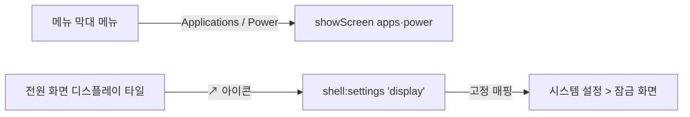

# 잠자기 방지 기본 시간 통일과 전원 바로가기

착수일: 2026-11-03
완료일: 2026-11-03

## 요청

1. 잠자기 방지 두 카드의 적용 시간 기본값을 모두 2시간으로
2. 메뉴 막대 메뉴에 앱 관리, 전원 화면으로 바로 가는 항목 추가
3. 디스플레이 끄기 카드에 해당 시스템 설정으로 바로 가는 작은 아이콘 추가

## 분석

| 요청 | 현재 상태 | 원인·관련 위치 |
|:---|:---|:---|
| 1 | 디스플레이를 연 상태 1시간, 닫은 상태 2시간 | 앱 화면 상태 초기값(`power.js` `keepAwakeMinutes: 60`, `lidMinutes: 120`)과 코어 기본값(`power.keep-awake` 60, `power.lid` 120)이 각각 따로 정해져 있음. 명령줄·에이전트도 같은 차이를 가짐 |
| 2 | 메뉴는 Folders, Open Turink Toys, Quit | `tray-menu.js` 의 메뉴 구성, `main.js` 의 `showScreen(id)` 로 특정 화면을 여는 기능은 이미 있음(Edit Folders… 가 사용) |
| 3 | 디스플레이 끄기 타일에 값만 표시 | macOS의 디스플레이 끄기 시간은 시스템 설정 > 잠금 화면에 있음. 렌더러가 외부 주소를 여는 통로(`shell:external`)는 앱 소유 주소 두 개만 허용 |

## 설계

1. 기본 시간: 코어 `power.keep-awake` 기본값을 120분으로 바꿔 `power.lid` 와 맞추고, 앱 화면은 두 카드가 하나의 기본값 상수(120분)를 쓰도록 정리
2. 메뉴 막대: 구성을 `Folders ▸` / `Applications`, `Power`, `Open Turink Toys` / `Quit` 으로 변경. 메뉴는 기존 원칙대로 모든 언어에서 영어. 테스트 갱신
3. 설정 바로가기
   - 아이콘: 오른쪽 위를 가리키는 작은 화살표(↗)를 타일 오른쪽 위 모서리에 배치. 마우스를 올리면 설명 표시
   - 동작: 새 IPC `shell:settings` 는 정해 둔 이름(`display`)만 받아 고정 주소(`x-apple.systempreferences:com.apple.Lock-Screen-Settings.extension`)를 엶. 렌더러가 임의 주소를 열 수 없도록 기존 보안 원칙 유지
   - 문구: 설명 한 줄(영어·한국어). 한국어는 글쓰기 3단계(초안 → Gemini 문체 교정 → 내용 검수) 적용
4. README: 메뉴 막대 설명이 이전 구성(덮개 상태, 실행 중 작업, 압축 바로가기)으로 남아 있어 현재 구성으로 고침

## 검증

- 앱·코어 테스트 실행
- 개발용 앱 실행 후 메뉴 항목 동작, 기본 시간 표시, 아이콘 클릭 시 잠금 화면 설정이 열리는지 확인

## 진행 상황

- 분석·설계 완료, 사용자 지시("이슈 없으면 진행")에 따라 착수
- 구현 완료
  - 코어 `power.keep-awake` 기본값 120분(예시는 4시간으로 변경), 앱 두 카드는 `DEFAULT_MINUTES = 120` 공유
  - 메뉴 막대: `Applications`, `Power` 항목 추가(`actions.screen(id)` → `showScreen`)
  - 디스플레이 끄기 타일 오른쪽 위 ↗ 버튼, `shell:settings` IPC(고정 매핑 `display`만 허용), 한국어 문구 「시스템 설정에서 변경」(Gemini 교정 결과 초안 유지, 내용 검수 이상 없음)
  - README 메뉴 막대 설명 현행화
- 검증
  - 테스트 72건 통과(메뉴 화면 이동 테스트 추가)
  - 명령줄 `help power.keep-awake` 기본값 120 확인
  - 개발용 앱 재설치(quit → bundle → 설치 → clean) 후 전원 화면에서 두 카드 모두 2시간 선택, ↗ 버튼 클릭 시 시스템 설정 「잠금 화면」 열림 확인
  - 메뉴 막대 항목은 단위 테스트로만 확인(메뉴 막대 클릭은 접근성 권한이 없어 직접 확인 못 함)
- 사용자 요청(11-03)으로 메뉴 막대 조정
  - 순서: 앱 관리, 전원, 폴더 ▸ / Open Turink Toys, Quit
  - 화면 이름 항목 세 개는 앱 창 언어를 따름(기존 `ui.nav.*` 번역 재사용, 언어 변경 시 메뉴 다시 구성). Open·Quit, 폴더 하위 메뉴 문구는 영어 유지
  - 테스트 73건 통과, 개발용 앱 재설치
- 사용자 확인(11-03) 후 완료 처리
